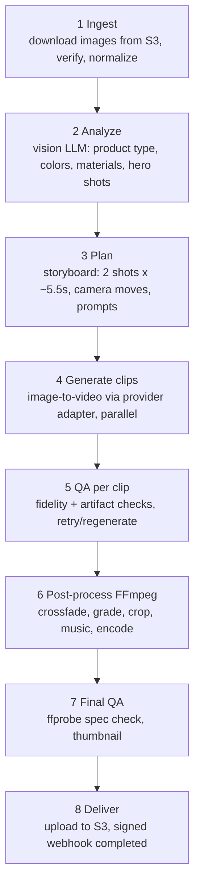

# AI Microservices (Python + FastAPI + FFmpeg)

**Status:** Draft v0.1 · Design only
Related: [PROJECT_ARCHITECTURE](PROJECT_ARCHITECTURE.md) · [API_DESIGN §10–11](API_DESIGN.md)

## 1. Responsibilities

The AI service turns **product images + a text brief** into a **10-second, 9:16, cinematic MP4** (plus thumbnail) and suggests platform-specific copy. It is **stateless with respect to business data**: Laravel is the system of record. The service keeps only transient job state in Redis and writes artifacts to S3.

Out of its scope: users, OAuth, publishing, approvals, billing.

## 2. Deployable units (one image, three commands)

| Unit | Command | Scales on | Notes |
|---|---|---|---|
| `ai-api` | `uvicorn app.main:app` | request rate | Validates, authenticates (HMAC), enqueues, serves status. No heavy work |
| `ai-worker` | `arq app.workers.WorkerSettings` | queue depth | Runs the pipeline; FFmpeg is CPU-bound → size by vCPU, 1–2 concurrent jobs per 4 vCPU |
| `ai-gpu-worker` *(Phase 7, optional)* | same code, GPU image/profile | GPU util | Self-hosted open-weight image-to-video models behind the same provider interface |

Redis: a **dedicated logical DB/prefix** for the AI queue (not shared with Laravel queues). Job records (`ai_job:{id}`) hold status, stage, progress, clip states, and are retained 7 days.

## 3. Pipeline



Each stage updates `stage` + `progress` (weights: ingest 5 · analyze 10 · plan 5 · generate 55 · QA 5 · post 15 · deliver 5) and emits a progress webhook. Every stage is **idempotent and resumable** from stored intermediates (S3 `work/` keys), so a worker crash resumes instead of re-paying for clips.

### 3.1 Ingest
- Fetch only the S3 keys provided. Re-decode with Pillow/libvips (rejects polyglot/corrupt files), apply EXIF orientation, strip metadata, convert to sRGB.
- Create working variants: long side ≤ 2048 px for the LLM, provider-ready crops (see 3.3).
- Background handling: optional background removal/cleanup *only if enabled* (Phase 4+), because it changes product appearance.

### 3.2 Analyze (vision LLM via `LLMProvider`)
Input: images (downscaled) + brief. Output (JSON, schema-validated with Pydantic, retried on invalid JSON):
```json
{
  "product": { "category": "bag", "materials": ["leather"], "colors": ["tan","brass"], "key_features": ["…"] },
  "images": [ { "media_id": "…", "shot_type": "front|detail|lifestyle|flat", "quality": 0.0-1.0, "usable_as_first_frame": true, "notes": "…" } ],
  "risks": ["contains_text_or_logo", "reflective_surface", "human_face_present"],
  "moderation": { "allowed": true, "reasons": [] }
}
```
The analysis is cached by `(sha256 of images + brief hash)` to avoid re-spend on regenerate.

### 3.3 Plan: the 10-second strategy
Most image-to-video models cap a single generation at a few seconds, and quality drops with length. Therefore the default plan is **two shots stitched with a 1-second crossfade**:

```
shot A: 5.5 s ─────────────┐
                     xfade 1.0 s
shot B:            └───────────── 5.5 s     → total = 5.5 + 5.5 − 1.0 = 10.0 s
```

| Strategy | When | How |
|---|---|---|
| **A. Two shots, two source images** (default when ≥ 2 usable images) | Best product fidelity and uses the user's multiple images | Shot A from hero image (e.g. slow dolly-in), shot B from detail/lifestyle image (e.g. parallax/orbit) |
| **B. Two shots, one image** | Only one usable image | Shot B starts from a different crop/zoom of the same image (macro detail) |
| **C. Native 10 s clip** | Provider supports ≥ 10 s reliably | Single call; skip crossfade; still run post-process |
| **D. Chained** *(experimental)* | Smooth continuity wanted | Use shot A's last frame as shot B's first frame; risk of drift/artifact accumulation |

Generation requests ask for slightly **more** than needed (e.g. 6 s) so trims and crossfades never run short; final duration is enforced by FFmpeg (`-t 10`).

**Prompt construction (per shot):** a deterministic template + LLM-authored camera/lighting text:
```
{subject from analysis}. Camera: {move: slow dolly-in | orbit 25° | parallax push | macro rack-focus}.
Lighting: {style preset}. Cinematic, shallow depth of field, natural motion, product shape and
logo unchanged, no text changes. [negative: warped logo, morphing shape, extra objects, text artifacts, flicker]
```
Style presets (`style_preset`): `cinematic_dolly`, `orbit_showcase`, `parallax_lifestyle`, `macro_reveal`, `minimal_studio`. Each maps to camera moves, grade LUT, and music mood.

### 3.4 Generate clips (provider abstraction)

```python
class VideoProvider(Protocol):
    name: str
    capabilities: ProviderCapabilities     # max_seconds, aspect_ratios, supports_end_frame, cost_per_second
    async def submit(self, req: ImageToVideoRequest) -> ProviderJob: ...
    async def poll(self, job: ProviderJob) -> ProviderStatus: ...   # queued|running|succeeded|failed + output url
    async def cancel(self, job: ProviderJob) -> None: ...
```
- **Adapters (build behind the interface, choose by config):** hosted aggregators/APIs (e.g. fal.ai, Replicate), model vendors (Runway, Luma, Kling, Google Veo, MiniMax, etc.), and **self-hosted** open-weight models (e.g. Wan, LTX-Video, HunyuanVideo, CogVideoX) via ComfyUI/Diffusers on GPU.
- **Selection:** Phase 2 runs a **bake-off** on ~20 representative product images (reflective, textured, logo-heavy, dark/white backgrounds), scoring fidelity, motion quality, failure rate, latency, and $/10 s video. Pick one primary + one fallback; keep the rest as plug-ins. *The model landscape changes monthly; no vendor is hard-wired by this design.*
- **Execution:** both shots submitted in parallel; poll with backoff (or provider webhooks where available); download result → `work/…/clipN.mp4`.
- **Resilience:** per-clip retry (≤ `max_attempts_per_clip`, default 2), automatic fallback provider on provider-side errors/timeouts, circuit breaker per provider, global concurrency semaphore per provider (respect their rate limits), hard timeout per clip (default 8 min).
- **Cost control:** `limits.max_cost_cents` per generation is checked before each submit; costs reported in every webhook and recorded in Laravel's `usage_ledger`.

### 3.5 QA (automatic, then human)
Per clip, before spending on post-processing:
1. **Technical:** `ffprobe` duration ≥ requested, resolution, no black/frozen frames (`blackdetect`, `freezedetect`).
2. **Fidelity:** sample N frames (first, 25 %, 50 %, 75 %, last); compare to source with an image-embedding similarity (e.g. CLIP/SigLIP) and/or a vision-LLM judge ("same product? logo/text intact? shape distortion? extra objects?") → `qa_score` 0–1.
3. **Policy:** frame-sample moderation (no unsafe/offensive output, no real-person likeness issues).
Below threshold → regenerate that clip (counts against attempts) → if still failing, mark `failed` with `error_code = qa_failed` and surface a useful message ("logo distortion detected; try a different hero image").
**Human approval in the UI remains mandatory** — QA reduces bad outputs, it does not replace the gate.

### 3.6 Post-process (FFmpeg)

Targets: master **1080×1920, 30 fps, H.264 High, yuv420p, AAC-LC 48 kHz stereo ≥ 128 kbps, MP4 with `+faststart`**. This satisfies Facebook/Instagram Reels (9:16, 24–60 fps, H.264, AAC 48 kHz) and YouTube Shorts-style vertical video.

Normalize each clip, then stitch + grade + audio in one pass (illustrative; real code builds the graph programmatically and is covered by tests):

```bash
ffmpeg -y -i clipA.mp4 -i clipB.mp4 -i music.mp3 \
  -filter_complex "
    [0:v]scale=1080:1920:force_original_aspect_ratio=increase,crop=1080:1920,fps=30,setsar=1,format=yuv420p[a];
    [1:v]scale=1080:1920:force_original_aspect_ratio=increase,crop=1080:1920,fps=30,setsar=1,format=yuv420p[b];
    [a][b]xfade=transition=fade:duration=1.0:offset=4.5[v0];
    [v0]eq=contrast=1.05:saturation=1.08,vignette=PI/6,trim=duration=10,setpts=PTS-STARTPTS[v];
    [2:a]atrim=0:10,afade=t=in:d=0.5,afade=t=out:st=9:d=1,loudnorm=I=-16:TP=-1.5:LRA=11[a_out]
  " \
  -map "[v]" -map "[a_out]" \
  -c:v libx264 -preset medium -crf 18 -profile:v high -pix_fmt yuv420p -r 30 \
  -c:a aac -b:a 192k -ar 48000 -ac 2 \
  -movflags +faststart -t 10 master.mp4
```
Notes: `xfade offset = shotA_length − fade_duration` (5.5 − 1.0 = 4.5). If a clip is not exactly 5.5 s, the planner trims it (`trim`/`setpts`) first. Silent videos still get an AAC silent track (`anullsrc`) so every platform accepts them. Optional overlays (product name, CTA) via `drawtext`/ASS subtitles with a bundled font; ensure text stays inside platform safe zones (≈ 150 px top, ≈ 280 px bottom of 1920).
Thumbnail: best-QA frame at ~1.5 s → `jpg` 1080×1920 (and 1280×720 variant for YouTube if needed).
Extra renditions (Phase 5+): 1:1 (1080×1080) and 16:9 (1920×1080) via blurred-background pad or smart crop.

### 3.7 Final QA + deliver
`ffprobe` assertions: duration 10.00 ± 0.05 s, 1080×1920, 30 fps, codecs as specified, file ≤ platform limits (target < 100 MB; expected ≈ 10–25 MB). Upload `master.mp4` + `thumb.jpg` to the keys in the request, then send the `completed` webhook with the technical metadata. Delete local temp files; `work/` objects expire by lifecycle (7 days).

### 3.8 Audio options
| Mode | MVP? | Notes |
|---|---|---|
| `none` | ✅ | Silent AAC track |
| `library` | ✅ | Licensed/royalty-free tracks curated by you, tagged by mood; **licensing must permit commercial social use** |
| `ai_music` / `voiceover` | ❌ (Phase 7) | Provider adapter for TTS/music; disclosure and licensing review required |

## 4. Copy suggestions (`/copy/suggest`)
Single LLM call using the cached analysis + brief + target platforms → per platform: title (YouTube ≤ 100 chars), caption, 5–15 hashtags, YouTube tags, and a thumbnail text idea. Respects `language`/`tone`. Output validated and length-clamped server-side; never auto-applied — the user edits in the Publish screen.

## 5. Moderation (`/moderation/check` and in-pipeline)
- **Pre-spend:** brief text + images checked (LLM classifier or moderation API) → block disallowed content *before* paying a video provider.
- **Post-generation:** frame sampling check.
- Rejections return structured reasons; Laravel maps them to `media_rejected` / `generation_failed` with a user-safe message. Logs keep reasons, not the content.

## 6. Provider/LLM configuration

```
AI_VIDEO_PROVIDER_PRIMARY=…         AI_VIDEO_PROVIDER_FALLBACK=…
AI_VIDEO_PROVIDER_<NAME>_API_KEY=…  AI_VIDEO_MAX_CONCURRENCY=4
AI_LLM_PROVIDER=…                   AI_LLM_MODEL=…            AI_LLM_VISION=true
AI_MAX_COST_CENTS_DEFAULT=150       AI_CLIP_TIMEOUT_SEC=480
S3_ENDPOINT=…  S3_BUCKET=…  S3_ACCESS_KEY=…  S3_SECRET_KEY=…
HMAC_SECRET_LARAVEL_TO_AI=…         HMAC_SECRET_AI_TO_LARAVEL=…
REDIS_URL=redis://redis:6379/2
```
Keys live in the secret manager; the service refuses to start if required settings are missing (`pydantic-settings`).

## 7. Reliability & failure handling

| Failure | Handling |
|---|---|
| Worker crash mid-job | Arq re-delivers; stages resume from S3 intermediates |
| Provider 5xx / timeout | Retry with backoff → fallback provider → fail with `provider_unavailable` (retryable) |
| Provider content-policy rejection | Fail fast with `provider_rejected`; no retry; message guides the user |
| QA failure | Regenerate clip (bounded) → `qa_failed` |
| Webhook delivery fails | Retry with exponential backoff up to 24 h; Laravel polling job reconciles |
| FFmpeg error | Capture stderr (truncated, redacted), fail with `postprocess_failed`; alert (indicates a bug) |
| Stuck job | Reaper marks jobs with no progress > 30 min as failed and notifies Laravel |
| Duplicate submission | Same `idempotency_key` → same `ai_job_id` |

Error codes returned in webhooks: `moderation_blocked`, `invalid_input`, `provider_unavailable`, `provider_rejected`, `qa_failed`, `postprocess_failed`, `cost_limit_exceeded`, `timeout`, `canceled`, `internal_error`.

## 8. Observability
Structured logs with `generation_id`, `ai_job_id`, `stage`, `provider`; metrics: stage duration histograms, provider latency/error/cost, QA score distribution, retry counts, queue depth, FFmpeg time and exit codes; traces (OpenTelemetry) from API → worker → provider calls. Store a per-job **cost breakdown** (LLM tokens, provider seconds, compute).

## 9. Testing
- **Unit:** planner math (offsets/durations), prompt templates, schema validation.
- **Provider adapters:** recorded HTTP fixtures (VCR-style); a `FakeProvider` returns local sample clips so the whole pipeline runs in CI without spend.
- **FFmpeg golden tests:** run on tiny synthetic clips; assert `ffprobe` output (duration, codec, resolution, fps, audio present).
- **Contract tests:** request/webhook JSON schemas shared with Laravel (`contracts/`).
- **Bake-off harness:** repeatable script + dataset to compare providers and prompt changes (fidelity score, cost, time).

## 10. Performance & cost envelope (planning numbers — validate in Phase 2)
- Wall-clock target: **p50 ≤ 5 min, p95 ≤ 10 min** per 10 s video (dominated by provider generation).
- FFmpeg post-process ≈ 10–40 s on 4 vCPU.
- Cost = 2 clips × provider price + LLM analysis/plan (cents) + compute. Record it per job; enforce `max_cost_cents`; expose per-workspace quotas via Laravel.

## 11. Risks specific to this service
1. **Output quality/fidelity variance** across models and product types → bake-off, QA, regenerate, human gate.
2. **Provider churn** (models, pricing, API changes) → adapters + fallback + contract tests.
3. **GPU self-hosting complexity** → deferred to Phase 7, only if provider cost justifies.
4. **Copyright/licensing** of music and of user-supplied imagery → license-vetted library only; ToS puts rights responsibility on the user.
5. **Safety/policy** (faces, brands, harmful content) → pre/post moderation and clear rejection messages.

---

# 12. Phase 6 as-built: five independent services

> This section describes what was actually built in Phase 6 and **supersedes sections 2 and 3 where they differ**
> (the original design assumed one image with three commands; the build is five separate services).
> Machine-readable contracts (OpenAPI 3.1) are in [`contracts/ai/`](../contracts/ai/); regenerate with
> `python scripts/export-ai-openapi.py` (CI fails if they drift from the code). Laravel does not call these
> services yet: that wiring is Phase 7.

## 12.1 Layout and runtime

| Service | Package | Compose name | What it does | Needs FFmpeg |
| --- | --- | --- | --- | --- |
| Image Analyzer | `image_analyzer` | `ai-image-analyzer` | Reads product photos (never modifies them), identifies the product, extracts colours, background, subject, shot type, quality and risks | no |
| Description Analyzer | `description_analyzer` | `ai-description-analyzer` | Turns the product description into ranked benefits, a 10 s scene timeline and structured provider prompts | no |
| Video Generator | `video_generator` | `ai-video-generator` | Provider abstraction for image-to-video; tracks provider job IDs, retries, timeouts, cost budget | yes (clip QA) |
| Video Renderer | `video_renderer` | `ai-video-renderer` | FFmpeg: zoom, crossfade, text, logo, music, MP4 master | yes |
| Video Optimizer | `video_optimizer` | `ai-video-optimizer` | Size control, aspect-ratio exports, thumbnails, final validation | yes |

Shared code lives in `services/common` (package `studio_common`): settings, errors, logging, HMAC middleware,
storage, job manager, FFmpeg helpers, health routes. Each service has its own `pyproject.toml`, tests and image
(`infra/docker/ai-services/Dockerfile`, build args `SERVICE`, `PACKAGE`, `FFMPEG`). Start any one with
`uvicorn --factory <package>.main:create_app`. In Compose every service listens on port 8000 **inside** the
private `backend`/`data` networks; none publishes a port and nginx routes none of them. The legacy `services/ai`
skeleton (`ai-api`) is untouched and will be retired in Phase 7.

## 12.2 Conventions shared by all five services

- **Auth.** Every request except `/healthz`, `/readyz` must carry the Laravel HMAC signature
  (`AI_HMAC_SECRET_LARAVEL_TO_AI`; mandatory outside `local`/`testing`, startup fails without it). Missing or invalid: `401`.
- **Errors.** `application/problem+json` (RFC 9457) with an extra stable `code`. Messages never include
  FFmpeg stderr, provider bodies, keys or file paths. Validation failures are `422` with per-field detail.
- **Media never travels in request bodies.** Requests carry storage keys (`videos/…`, no `..`, no hidden or empty
  parts). Body limit 256 KB (`AI_MAX_BODY_BYTES`).
- **Async jobs.** `POST` returns `202` with a job (`id`, `status`: queued | running | succeeded | failed | canceled,
  `stage`, `progress` 0–1, `result`, `error{code,message,retryable}`); repeating a request with the same
  `idempotency_key` returns `200` and the same job. `GET …/{id}` polls, `POST …/{id}/cancel` stops work. State is kept in
  Redis (DB 2) for `AI_JOB_TTL_SECONDS` (7 days). A restart marks in-flight jobs `failed` (`retryable: true`); the caller resubmits.
- **Health.** `GET /healthz` (liveness, no dependencies) and `GET /readyz` (storage, job store, plus `ffmpeg`
  / `font` where relevant; `503` when a check fails).
- **Logging.** One JSON object per line on stdout with `timestamp, level, service, logger, message, request_id`;
  the request ID is accepted from `X-Request-Id` or generated and returned.
- **Credentials.** All provider, model and storage keys come from environment variables (`AI_*`), are `SecretStr`,
  travel only in `Authorization` headers and are never logged. `.env.example` lists every variable with empty values.

## 12.3 Image Analyzer: `POST /v1/analyze` (sync)

Request: `images[1..10]{media_id, storage_key}`, `brief{title, description}` (optional), `use_vision` (default false).
Response: `images[]` (per image: `media_id, width, height, aspect_ratio, format, sha256`, `quality{score, sharpness, brightness, contrast}`,
`colors[{name, hex, share}]`, `background{kind: white|solid|complex, hex}`, `subject{box, coverage, centered}`,
`shot_type` front | detail | lifestyle | flat, `usable_as_first_frame`, `risks[]`), `product` (`name, category, colors, materials,
key_features, visible_text, has_logo, has_people, confidence`, `source`: `heuristic` | `vision`), `preservation` and `warnings[]`.

`preservation` is the contract that protects the product's look: `original_modified` is always `false` (a literal in the schema), `hero_media_id` is
the best first frame, `must_preserve[]` lists shape/colour/logo constraints and `negative_prompt_terms[]` is appended to every
generation prompt. Originals are opened read-only. Vision (optional, `AI_VISION_BASE_URL/MODEL/API_KEY`, any
OpenAI-compatible endpoint) output is validated, clamped and stripped of URLs before use. Errors: `too_many_images`,
`duplicate_media_id`, `image_empty`, `image_too_large`, `image_dimensions_too_large`, `image_unsupported_type`, `media_not_found`.

## 12.4 Description Analyzer: `POST /v1/describe` (sync)

Request: `title`, `description` (1–2000 chars), `product` hint (`category, colors, materials`), `images[≤10]` hints from the image
analysis (`media_id, quality_score, shot_type, usable_as_first_frame`), `language`, `tone` (luxury | playful | energetic | calm |
professional | friendly), `style_preset` (`cinematic_dolly`, `orbit_showcase`, `parallax_lifestyle`, `macro_reveal`, `minimal_studio`),
`negative_prompt_terms` (from `preservation`), `use_llm`.
Response: `summary`, `product`, `benefits[]` (`rank, text, evidence`), `features[]`, `keywords[]`, `tone`, `call_to_action`,
`claims_to_review[]` (superlatives, medical, price and guarantee claims for a human to confirm), `style_preset`, `timeline`
(`strategy`: `two_images` | `one_image` | `description_only`, `total_duration_seconds` 10.0, `crossfade_seconds` 1.0, `scene_count`),
`scenes[]` (`index, start_seconds` 0 and 4.5, `duration_seconds` 5.5, `description, camera_move, lighting, overlay_text,
source_media_id`), `prompts[]` (`scene_index, media_id, prompt, negative_prompt, duration_seconds, request_seconds`),
`source` (`rules` | `llm`) and `warnings[]`.

Ten seconds = two 5.5 s shots with a 1.0 s overlap (`5.5 + 5.5 − 1.0`); provider requests are padded by 0.5 s so the
renderer can trim. With an optional LLM (`AI_LLM_*`) the text is refined, but model output is schema-validated and falls back
to the rule-based plan on any problem. User text is treated as data, never as instructions to the model.

## 12.5 Video Generator: `POST /v1/generations` (async)

Request: `idempotency_key`, `output_prefix`, `shots[1..4]{shot_id, image_key, prompt, negative_prompt, duration_seconds,
request_seconds}`, `aspect_ratio` (`9:16` default | `1:1` | `16:9`), `provider` (optional override, must be configured),
`max_cost_cents`, `seed`, `timeline{total_duration_seconds, crossfade_seconds}`. Result: `clips[]{shot_id, storage_key, provider,
provider_job_id, duration_seconds, width, height, cost_cents, attempts}`, `attempted_provider_jobs[]`, `total_cost_cents`. While running,
`GET /v1/generations/{id}` also returns `shots[]{state, provider, provider_job_id, attempts, error_code}` so progress and external
job IDs are visible live. `GET /v1/providers` lists configured providers (`name, role, max_seconds, aspect_ratios, cost_cents_per_second`; no secrets).

Provider interface (`providers/base.py`): `submit(request) → ProviderJob`, `poll(job) → ProviderStatus`, `fetch(job, status, destination)`, `cancel(job)`,
plus `capabilities` (max seconds, aspect ratios, cost per second). Adapters: `fake` (deterministic synthetic clip with FFmpeg;
**refused in staging/production**) and `http` (a generic REST adapter; its contract is documented in `providers/http.py`, and a vendor-specific
adapter is a small subclass). Behaviour: primary → fallback chain, bounded retries, exponential-backoff polling, a per-clip
timeout that **cancels the external job**, a circuit breaker per provider, a cost budget checked before every submit, and a
clip QA step (ffprobe: decodes, duration, resolution). Every external job ID, including abandoned attempts, is recorded so Laravel can
reconcile with the vendor. Download URLs must be `https`, must not resolve to private/loopback addresses, and can be pinned to hosts with
`AI_VIDEO_HTTP_DOWNLOAD_HOSTS`. Errors (in `error.code`): `provider_rejected` (fails fast, not retried), `provider_unavailable`,
`provider_auth_failed`, `timeout`, `cost_limit_exceeded`, `qa_failed`, `unknown_provider`, `unsupported_aspect_ratio`.

## 12.6 Video Renderer: `POST /v1/renders` (async)

Request: `output_key` (`.mp4`), `aspect_ratio` (`9:16` | `1:1` | `16:9`), `resolution` (`full` 1080×1920 | `preview` half), `fps`,
`duration_seconds` (must equal `sum(segments) − transition × (n−1)`), `quality` (`draft` | `standard` | `high`),
`segments[]` (`kind` `clip` | `image`, `key`, `duration_seconds`, `zoom{style: in|out|none, amount, focus_x, focus_y}`),
`transition` (whitelisted `xfade` type, duration), `grade`, `overlays[≤4]` (text, start, end, position, size, `#rrggbb`), `logo`
(`key`, corner, width, opacity), `music` (`key`, volume, fades, loudness normalisation, loop).
Result: `output_key, size_bytes, duration_seconds, width, height, fps, has_audio`.

Output is H.264 High, yuv420p, 30 fps, AAC 48 kHz stereo, `+faststart`. Overlays stay inside the platform safe zones (top 9 %,
bottom 15 %). The filter graph is built by a pure function (`graph.build_plan`) and unit-tested. Security: every FFmpeg input is
opened with `-protocol_whitelist file` (so a crafted playlist cannot reach the network), formats/codecs are allow-listed, text is
passed through a text file with `expansion=none` (never inside the filter string), colours are validated, and text in scripts that
FFmpeg cannot shape (Arabic, Urdu, Devanagari, …) is refused with `unsupported_text_script`; use an image overlay for those.
Errors: `unsupported_input`, `input_too_large`, `input_too_long`, `clip_too_short`, `music_too_short`, `too_many_segments`,
`unsupported_text_script`, `media_not_found`, `postprocess_failed`.

## 12.7 Video Optimizer: `/v1/validate` (sync), `/v1/optimizations` (async)

`POST /v1/validate` `{video_key, profile, expected_duration_seconds?, deep?}` → `{valid, profile, checks[], facts}`. Each check
has `name, passed, severity (error|warning), expected, actual`. Checks: container MP4, H.264, `yuv420p`, AAC, 48 kHz, stereo,
faststart (`moov` before `mdat`), frame rate 23–60, duration range for the profile, optional expected duration (±0.1 s), aspect ratio
(9:16 profiles), file size, even dimensions; `deep: true` adds `black_frames` and `frozen_frames` (warnings only, because a dark
scene can be intentional). Profiles: `master`, `instagram_reels`, `facebook_reels`, `youtube_shorts`, `youtube_video`. The numbers
in each profile are **our conservative delivery targets, not the platforms' published maxima**; review them against each platform's
current documentation before launch.

`POST /v1/optimizations` `{idempotency_key, video_key, output_prefix, outputs[1..6], thumbnails}`; each output has `name`,
`aspect_ratio` (`9:16`, `1:1`, `4:5`, `16:9`), `mode` (`crop` with `focus_x`, or `pad_blur`: whole picture over a blurred copy),
`crf`, `preset`, `max_size_mb`, optional `profile` to validate against. Size control: encode at CRF; if the file is over the target,
re-encode with a bit-rate derived from the target (up to 3 attempts), otherwise fail with `size_target_unreachable`. Thumbnails: the
sharpest of N sampled frames (or `at_seconds`), cropped to each requested ratio, written as JPEG. Output files are stored at
`{output_prefix}/{name}.mp4` and `{output_prefix}/{name}.jpg`. An output that fails its profile is **not stored** and the job fails with
`output_invalid`. Errors: `unsupported_input`, `input_too_large`, `input_too_long`, `input_too_short`, `too_many_outputs`,
`size_target_unreachable`, `output_invalid`, `media_not_found`.

## 12.8 Configuration summary

| Variable | Used by | Notes |
| --- | --- | --- |
| `AI_ENVIRONMENT` | all | `local` / `testing` / `staging` / `production` |
| `AI_HMAC_SECRET_LARAVEL_TO_AI` | all | required outside local; generated by `make init` |
| `REDIS_URL` | all | job state; Compose uses Redis DB 2 |
| `AI_STORAGE_BACKEND`, `AI_STORAGE_LOCAL_ROOT`, `AI_S3_*` | all | shared media; `local` = the `ai-media` volume |
| `AI_VISION_*` | image analyzer | optional vision model |
| `AI_LLM_*` | description analyzer | optional language model |
| `AI_VIDEO_PROVIDER_PRIMARY/FALLBACK`, `AI_VIDEO_HTTP_*` | generator | provider selection and credentials |
| `AI_MAX_CONCURRENT_JOBS` | async services | default 2 |

## 12.9 Testing and known limits

Each package has its own suite (`make test-ai`): common 35, image analyzer 28, description analyzer 29, video generator 46,
video renderer 38, video optimizer 18. Renderer and optimizer tests run real FFmpeg on synthetic media and inspect the output with
ffprobe and pixel comparisons. Known limits: the S3 storage backend and the vision/LLM/HTTP-provider paths are covered by mocks only
(no live account was available); no vendor-specific provider adapter ships yet; jobs execute in-process, so a crash loses the running
attempt (it is marked failed and must be resubmitted); right-to-left and complex-script text overlays are refused rather than
rendered badly; there is no embedding-based check that generated motion kept the product identical, only the prompt constraints and
human preview/approval; the Docker images were validated by an equivalent clean install and run, not built, because the build
environment had no Docker daemon (CI validates the Compose file syntax only).
