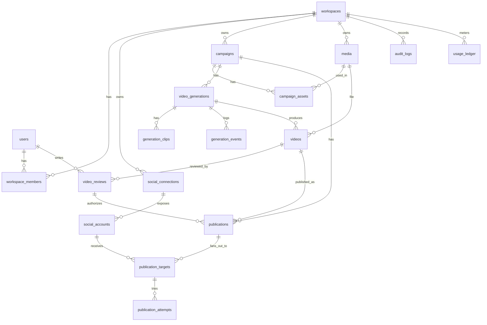

# Database Design (MySQL 8.4)

**Status:** Draft v0.1 · Design only
Related: [PROJECT_ARCHITECTURE](PROJECT_ARCHITECTURE.md) · [API_DESIGN](API_DESIGN.md)

## 1. Conventions

- Engine InnoDB, charset `utf8mb4`, collation `utf8mb4_0900_ai_ci`.
- PK: `BIGINT UNSIGNED AUTO_INCREMENT` internally; **public IDs are ULIDs** (`ulid CHAR(26) UNIQUE`) exposed by the API (no enumerable IDs).
- Timestamps: `created_at`, `updated_at` (`TIMESTAMP`, UTC). Soft deletes (`deleted_at`) only on `campaigns`, `media`, `social_accounts`.
- Enums stored as `VARCHAR` + PHP backed enums (easier migrations than MySQL `ENUM`).
- JSON columns only for flexible, non-queried payloads.
- Every tenant-owned table carries `workspace_id` (indexed) to make scoping and tenant deletion cheap.
- Columns marked 🔒 are **encrypted at the application layer** (Laravel `encrypted` cast); they cannot be indexed or queried.
- Money in integer cents (`cost_cents`).

## 2. Entity-relationship diagram



## 3. Tables

### 3.1 Identity & tenancy

**users** — `id, ulid, name, email (unique), email_verified_at, password, two_factor_secret🔒 (nullable), remember_token, last_login_at, created_at, updated_at`

**workspaces** — `id, ulid, name, owner_id → users, plan (default 'free'), settings JSON, created_at, updated_at`

**workspace_members** — `workspace_id → workspaces, user_id → users, role (owner|admin|editor|viewer), invited_by, created_at` · PK `(workspace_id, user_id)` · index `(user_id)`

(Laravel defaults also created: `sessions`, `cache`, `cache_locks`, `jobs`, `job_batches`, `failed_jobs`, `password_reset_tokens`.)

### 3.2 Media

**media** — `id, ulid, workspace_id, created_by → users, kind (image|clip|video|thumbnail|audio), disk, object_key (unique), original_name, mime, bytes, sha256, width, height, duration_ms (nullable), status (pending_upload|uploaded|validated|rejected|deleted), rejection_reason, exif_stripped (bool), expires_at (nullable, for work files), created_at, updated_at, deleted_at`
Indexes: `(workspace_id, kind, status)`, `(sha256)` for dedupe, `(expires_at)` for purge job.

### 3.3 Campaigns

**campaigns** — `id, ulid, workspace_id, created_by, title, product_name, product_description TEXT, language (BCP-47, default 'en'), tone (nullable), brand_notes TEXT, target_audience, status (draft|ready|archived), created_at, updated_at, deleted_at`
Index: `(workspace_id, status, created_at)`.

**campaign_assets** — `id, campaign_id, media_id, position SMALLINT, role (hero|detail|lifestyle|other), note VARCHAR(255)` · unique `(campaign_id, media_id)`, unique `(campaign_id, position)`
Rule: 1–10 images per campaign (enforced in service; MVP default max 10).

### 3.4 Generation

**video_generations** — one row per *attempt/version*.
`id, ulid, workspace_id, campaign_id, requested_by, version INT (per campaign), status, style_preset (e.g. cinematic_dolly|orbit|parallax|macro_reveal), duration_ms (default 10000), aspect_ratio (default '9:16'), params JSON (user options + prompt notes), storyboard JSON (nullable, written by AI), provider, provider_job_ref, ai_job_id, progress TINYINT, stage VARCHAR(32), error_code, error_message, cost_cents INT default 0, idempotency_key (nullable, unique per workspace), started_at, finished_at, created_at, updated_at`
Indexes: `(campaign_id, version)` unique, `(workspace_id, status)`, `(ai_job_id)`.

**generation_clips** — `id, generation_id, idx TINYINT, source_media_id → media, prompt TEXT, negative_prompt TEXT, provider_job_ref, status (queued|running|succeeded|failed|rejected_by_qa), clip_media_id → media (nullable), duration_ms, qa_score DECIMAL(5,2), attempt TINYINT, error_code` · unique `(generation_id, idx, attempt)`

**generation_events** (append-only audit of AI pipeline) — `id, generation_id, event_id (unique, from webhook), type, payload JSON, occurred_at, received_at`

**videos** — final renditions: `id, ulid, workspace_id, generation_id, media_id → media, thumbnail_media_id → media, aspect_ratio, width, height, duration_ms, fps, video_codec, audio_codec, has_audio bool, bytes, is_current bool, created_at`
Index: `(generation_id)`, `(workspace_id, created_at)`.
(Phase 2+ may add 1:1 and 16:9 renditions as extra `videos` rows linked to the same generation.)

### 3.5 Review (approval gate)

**video_reviews** — `id, ulid, workspace_id, video_id, reviewer_id → users, decision (approved|rejected|changes_requested), comment TEXT, created_at` · index `(video_id, created_at)`
A video is *approved* iff its latest review is `approved`. A new generation always starts unapproved.

### 3.6 Social

**social_connections** — one OAuth grant (a user's Facebook login, or a Google login).
`id, ulid, workspace_id, connected_by → users, provider (meta|google), provider_user_id, display_name, email (nullable), access_token🔒, refresh_token🔒 (nullable), token_type, token_expires_at (nullable), granted_scopes JSON, status (active|expiring|expired|revoked|error), last_validated_at, last_error, created_at, updated_at`
Unique: `(workspace_id, provider, provider_user_id)`.

**social_accounts** — a *publishable destination* discovered via a connection.
`id, ulid, workspace_id, connection_id → social_connections, platform (facebook_page|instagram_business|youtube_channel), external_id, name, username (nullable), avatar_url, page_access_token🔒 (facebook_page/instagram only), linked_page_external_id (instagram only), is_enabled bool, status (active|needs_reconnect|revoked|restricted), capabilities JSON (e.g. max_duration, aspect_ratios), last_publish_at, created_at, updated_at, deleted_at`
Unique: `(workspace_id, platform, external_id)`.

**oauth_states** (or cache-backed; table chosen for auditability) — `id, state_hash (unique), workspace_id, user_id, provider, code_verifier🔒 (PKCE), redirect_after, expires_at, used_at`

### 3.7 Publishing

**publications** — a user's "publish this video" action.
`id, ulid, workspace_id, campaign_id, video_id, approved_review_id → video_reviews NOT NULL, created_by, title (nullable), caption TEXT, hashtags JSON, scheduled_at (nullable), status (draft|scheduled|publishing|published|partial|failed|canceled), idempotency_key, created_at, updated_at`
Indexes: `(workspace_id, status)`, `(status, scheduled_at)` for the scheduler.

**publication_targets** — fan-out per social account.
`id, ulid, publication_id, social_account_id, status (pending|uploading|processing|published|failed|canceled), platform_options JSON (per-platform title/tags/privacy/etc.), platform_container_id, external_post_id, external_url, attempts TINYINT, next_attempt_at, last_error_code, last_error_message, published_at, created_at, updated_at`
Unique: `(publication_id, social_account_id)` · Index: `(status, next_attempt_at)`.

**publication_attempts** — `id, target_id, started_at, finished_at, outcome (success|retryable_error|permanent_error), http_status, error_code, response_summary JSON (redacted), duration_ms`

### 3.8 Platform support

**inbound_events** — webhook/callback dedupe: `id, source (ai|meta|google), event_id, payload JSON, signature_valid bool, processed_at, error, created_at` · unique `(source, event_id)`

**audit_logs** — `id, workspace_id, actor_id (nullable), action, subject_type, subject_id, ip, user_agent, meta JSON, created_at` · index `(workspace_id, created_at)`

**usage_ledger** — `id, workspace_id, kind (video_generation|llm_tokens|storage_gb_day), units, cost_cents, ref_type, ref_id, created_at` · index `(workspace_id, kind, created_at)` (feeds quotas and later billing)

## 4. State machines

**video_generations.status**

```
queued → analyzing → planning → generating → postprocessing → ready_for_review
   │         │           │           │             │
   └─────────┴───────────┴───────────┴─────────────┴──→ failed
queued|analyzing|planning|generating|postprocessing → canceled
```
`ready_for_review` is terminal for the AI side; review decisions live in `video_reviews`. "Regenerate" creates a **new** `video_generations` row (version+1).

**publications / publication_targets**

```
target:  pending → uploading → processing → published
            └──────────┴───────────┴──→ failed (retryable → pending w/ next_attempt_at)
publication.status derived: all published → published; some → partial; all failed → failed
```

Transitions are implemented in one place per aggregate (`transitionTo()`), reject invalid moves, and write an audit/event row.

## 5. Integrity rules not expressible as plain FKs (enforced in services + tests)

1. A `publication` may only reference a `video` whose **latest** review is `approved` and equals `approved_review_id`.
2. A `publication_target.social_account` must belong to the same `workspace_id` as the publication and have `is_enabled = 1` and `status = active`.
3. `campaign_assets` media must be `kind = image`, `status = validated`, same workspace.
4. Only one `videos.is_current = 1` per generation (partial-unique emulated via service lock).
5. Deleting a `social_connection` revokes at the provider first, then nulls tokens and marks accounts `revoked` (rows kept for publication history).

## 6. Retention & privacy

| Data | Retention |
|---|---|
| Source uploads | Until campaign deleted (user-controlled) |
| Intermediate clips (`work/`) | 7 days (S3 lifecycle + `PurgeExpiredMedia`) |
| Final videos | Until campaign deleted or workspace closed |
| `generation_events`, `publication_attempts` | 90 days |
| `audit_logs` | 12 months |
| OAuth tokens | Removed immediately on disconnect, deauthorize callback, or account deletion |

User deletion / Meta data-deletion callback → queued job removes personal data, tokens and media, keeps anonymized aggregate `usage_ledger`.

## 7. Indexing & performance notes

- Hot paths: list campaigns by workspace; poll generation by ULID; scheduler scan `(status, scheduled_at)`; target retry scan `(status, next_attempt_at)`.
- Use keyset pagination on `(created_at, id)` for lists.
- Row-level locks (`SELECT … FOR UPDATE`) when applying webhooks to a generation (prevents out-of-order event races).
- Large JSON (`storyboard`) stays on `video_generations`; if it grows, move to `generation_storyboards`.

## 8. Migration order

`users, workspaces, workspace_members → media → campaigns, campaign_assets → social_connections, oauth_states, social_accounts → video_generations, generation_clips, generation_events, videos → video_reviews → publications, publication_targets, publication_attempts → inbound_events, audit_logs, usage_ledger`

## 9. Phase 2 implementation notes

Implemented in `apps/api/database/migrations` (15 files). Where it differs from the design above:

- **Ownership is per user.** Every business table has `user_id`; there are no `workspaces` yet.
  Child tables reference their parent with a composite foreign key `(parent_id, user_id)` so a row
  can never belong to a different user than its parent (enforced by the database, not only policies).
- **Public ids** are ULIDs in a `ulid` column; auto-increment ids never leave the API.
- **Roles and permissions**: `roles`, `permissions`, `permission_role`, `role_user`; `member` and
  `admin` are created by a migration through the idempotent `RoleCatalog::sync()`.
- **Tokens**: `social_tokens` holds one row per account and kind (access/refresh) with
  Laravel-encrypted ciphertext in `text` columns; the model hides them from serialization.
- **Review state** lives on `generated_videos` (`approval_status`, `reviewed_at`, `review_comment`);
  a separate `video_reviews` table is deferred until multi-reviewer workflows exist.
- **Audit log** is append-only: the model refuses updates and deletes; `user_id` is nulled when the
  user is deleted so history survives account deletion.
- Value constraints (statuses, ranges) are CHECK constraints on MySQL, created through `SqlCheck`;
  the SQLite test database skips them and the CI MySQL step proves them.

## Phase 4 additions (as built)

- `oauth_states` (new): `user_id` (cascade), `state_hash CHAR(64) UNIQUE` (SHA-256 of the random state; the raw value is never stored), `platform`, `code_verifier` (encrypted, PKCE), `expires_at`, `consumed_at`, `created_at`. Single use, 10-minute lifetime, pruned daily by `model:prune`.
- `social_accounts`: added `status_reason VARCHAR(255)` (why it is not active, shown to the user), `last_checked_at`, `profile JSON` (followers, subscribers, account type, …). The provider CHECK is now `IN ('meta','instagram','google')` (Instagram Login is its own provider with its own app credentials).
- `social_tokens` is unchanged: `access_token` / `refresh_token` hold ciphertext, one `access` row per account, `last_error` records the last failure code. Facebook Page tokens have `expires_at NULL` (non-expiring).
- Disconnecting deletes the token rows and soft-deletes the account (`status = revoked`); reconnecting the same Page/channel restores the same row and public id.
