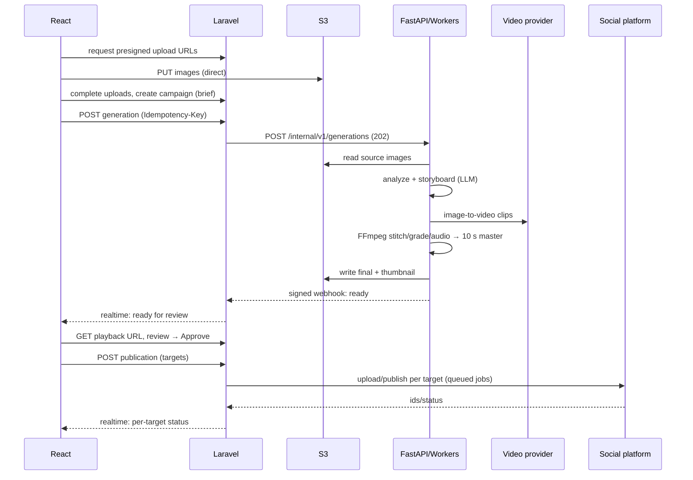

# AI Social Media Studio — Project Architecture

**Status:** Draft v0.1 (design only, no code written)
**Date:** 2026-11-12
**Repo analysis result:** `github.com/bilz123/ai-social-studio` was **empty** (no commits, branches, files, dependencies or configs). This is a **greenfield design**. Steps 1–4 of the brief (inspect structure, dependencies, existing code, missing components) therefore reduce to: *everything is missing*; the full component list is in §3.

Related docs: [DATABASE_DESIGN](DATABASE_DESIGN.md) · [API_DESIGN](API_DESIGN.md) · [AI_MICROSERVICES](AI_MICROSERVICES.md) · [SOCIAL_MEDIA_INTEGRATION](SOCIAL_MEDIA_INTEGRATION.md) · [DEVELOPMENT_ROADMAP](DEVELOPMENT_ROADMAP.md)

---

## 1. Product scope

A user connects Facebook, Instagram and YouTube accounts, uploads several product images, writes a product description, and the system generates a **10-second cinematic motion video**. The user previews it, approves (or rejects/regenerates), then publishes it to one or more connected accounts.

**In scope (MVP):** auth + workspaces, multi-image upload, product brief, AI video generation (10 s, vertical 9:16 master), preview + mandatory approval, OAuth connect for Facebook Pages / Instagram professional accounts / YouTube channels, multi-target publishing with per-target status and retry.

**Out of scope (MVP):** billing, analytics dashboards, comment/DM management, TikTok/X/LinkedIn, long-form video, team approval chains, mobile apps. The design leaves seams for them (§5, ADR-9).

## 2. System context

```mermaid
flowchart LR
  U[User browser] -->|HTTPS| NX[Nginx]
  NX --> WEB[React SPA static build]
  NX --> API[Laravel API<br/>php-fpm]
  API --> DB[(MySQL)]
  API --> RD[(Redis)]
  API --> S3[(S3-compatible storage)]
  HZ[Laravel Horizon workers] --> RD
  HZ --> DB
  HZ -->|internal REST, signed| AI[FastAPI AI service]
  AI --> RD2[(Redis: AI queue)]
  AIW[Python AI workers + FFmpeg] --> RD2
  AIW --> S3
  AIW -->|HTTPS| PROV[Video model provider(s)]
  AIW -->|HTTPS| LLM[Vision LLM]
  AIW -->|signed webhook| API
  HZ -->|Graph API| META[Meta: Facebook + Instagram]
  HZ -->|Data API v3| YT[YouTube]
  U -.->|OAuth redirects| META
  U -.->|OAuth redirects| YT
  API --> WS[Laravel Reverb websockets] -.-> U
```

## 3. Components (all to be created)

| # | Component | Purpose |
|---|---|---|
| 1 | `apps/api` Laravel | System of record, auth, OAuth, orchestration, publishing |
| 2 | `apps/web` React + Vite + TS + Tailwind | Studio UI |
| 3 | `services/ai` FastAPI + workers | Analysis, storyboard, motion generation, FFmpeg post-processing |
| 4 | MySQL | Relational data |
| 5 | Redis | Laravel queues/cache/locks; separate logical DB for AI queue |
| 6 | S3-compatible storage (MinIO in dev) | Images, clips, final videos, thumbnails |
| 7 | Reverb | Realtime progress to the UI |
| 8 | Docker Compose (dev) / container platform (prod) | Deployment |
| 9 | CI (GitHub Actions) | Lint, test, build, image publish |

## 4. Technology & version policy

Versions were **not** pinned because there is no lockfile yet. Policy: use the latest stable at scaffold time and pin via lockfiles; record exact versions in the README at the end of Phase 0.

| Layer | Choice | Notes |
|---|---|---|
| Backend | Laravel (latest stable) on PHP 8.3+ | Sanctum (SPA cookie auth), Horizon, Reverb, Socialite (+ SocialiteProviders where needed), Flysystem S3 |
| Frontend | React + Vite + TypeScript (strict) | TanStack Query, React Router, React Hook Form + Zod, Tailwind CSS |
| AI service | Python 3.12, FastAPI, Pydantic v2, uvicorn | Worker framework: Arq or Celery on Redis (decide in Phase 2 spike; default **Arq**, async-native) |
| DB | MySQL 8.4 LTS | utf8mb4, InnoDB |
| Queue/cache | Redis 7+ | Persistence (AOF) on for queues |
| Video | FFmpeg 6+ (static build in AI image) | Software x264; NVENC optional on GPU nodes |
| Storage | S3 API (AWS S3, Cloudflare R2, Backblaze B2, or MinIO) | Private buckets only |
| Deploy | Docker, multi-stage images | |
| Quality | Pest, Larastan, Pint · Vitest, ESLint, Playwright · pytest, ruff, mypy | |

## 5. Key architecture decisions (ADRs, condensed)

| ID | Decision | Why | Alternative rejected |
|---|---|---|---|
| ADR-1 | **Modular monolith** for Laravel, separate Python service | One team, one DB, simple ops; Python only where ML/FFmpeg ecosystem demands it | Microservices everywhere |
| ADR-2 | **Laravel owns all state**; Python is stateless w.r.t. business data | Single source of truth; Python can be scaled/replaced freely | Python writing to MySQL |
| ADR-3 | **Async job protocol**: Laravel → `POST` job to Python (202) → Python → signed webhook; polling as fallback | Generation takes minutes; decoupled | Sync HTTP; shared Redis queue between PHP and Python |
| ADR-4 | **Files move by S3 keys / presigned URLs, never through Laravel or HTTP bodies** | Avoids memory/timeouts; cheap | Proxying uploads |
| ADR-5 | **Provider abstraction** for video models and LLM | Model landscape changes monthly; avoid lock-in; enables bake-offs and cost routing | Hard-coding one vendor |
| ADR-6 | **Sanctum cookie (SPA) auth**, same-site deployment (`app.` and `api.` under one registrable domain) | No token storage in JS; CSRF-protected | JWT in localStorage |
| ADR-7 | **Mandatory approval gate** enforced in the domain layer *and* DB (`publications.approved_review_id NOT NULL`) | Product requirement; AI output must never auto-publish | UI-only check |
| ADR-8 | **Social tokens encrypted at rest**, accessed only by publishing/health jobs | Highest-value secrets in the system | Plain columns |
| ADR-9 | **`SocialPlatform` strategy interface** (`connect`, `listAccounts`, `publish`, `status`, `revoke`) | Adding TikTok/LinkedIn later = one new class | `if platform ===` sprawl |
| ADR-10 | **Public marketing site server-rendered by Laravel (Blade)**; studio SPA at `/app`, `noindex` | SEO where it matters, SPA where it doesn't | SSR the whole SPA |

## 6. Proposed repository layout

```
ai-social-studio/
├─ apps/
│  ├─ api/                      # Laravel
│  │  ├─ app/
│  │  │  ├─ Domain/
│  │  │  │  ├─ Identity/        # users, auth, workspaces, members
│  │  │  │  ├─ Media/           # uploads, presign, validation
│  │  │  │  ├─ Campaigns/       # product brief + assets
│  │  │  │  ├─ Generation/      # generations, clips, AI client, webhook handler
│  │  │  │  ├─ Review/          # reviews, approval gate
│  │  │  │  ├─ Social/          # connections, accounts, platform strategies
│  │  │  │  │  └─ Platforms/    # FacebookPlatform, InstagramPlatform, YouTubePlatform
│  │  │  │  └─ Publishing/      # publications, targets, attempts, scheduler
│  │  │  ├─ Http/
│  │  │  │  ├─ Controllers/Api/V1/
│  │  │  │  ├─ Controllers/Internal/   # AI webhook, Meta callbacks
│  │  │  │  ├─ Requests/ · Resources/ · Middleware/
│  │  │  ├─ Jobs/ · Events/ · Policies/ · Providers/
│  │  ├─ config/ · database/{migrations,factories,seeders} · routes/{api,internal,web}.php
│  │  ├─ resources/views/marketing/   # public SEO pages (Blade)
│  │  └─ tests/{Unit,Feature,Contract}
│  └─ web/                      # React
│     ├─ src/
│     │  ├─ app/                # router, providers, layout
│     │  ├─ features/{auth,workspaces,campaigns,media,generation,review,social,publishing}/
│     │  │   └─ {api,components,hooks,pages,schemas,types}
│     │  ├─ shared/{ui,lib,hooks,config}
│     │  └─ main.tsx
│     └─ vite.config.ts · tailwind config · tsconfig (strict)
├─ services/
│  └─ ai/                       # FastAPI + workers (single image, two commands)
│     ├─ app/
│     │  ├─ api/                # routers: generations, copy, health
│     │  ├─ core/               # config, security (HMAC), logging
│     │  ├─ pipeline/           # stages: ingest, analyze, plan, generate, post, deliver
│     │  ├─ providers/          # video/, llm/ adapters + base protocols
│     │  ├─ media/              # ffmpeg wrappers, probing, QA
│     │  ├─ storage/            # S3 client
│     │  ├─ workers/            # Arq tasks
│     │  └─ schemas/            # Pydantic models (shared contract)
│     └─ tests/
├─ contracts/                   # OpenAPI for public API + internal AI API, JSON schemas, webhook samples
├─ infra/
│  ├─ docker/{api,web,ai,nginx}/  # Dockerfiles, nginx conf
│  ├─ compose/{docker-compose.yml,docker-compose.override.yml,docker-compose.gpu.yml}
│  └─ ci/
├─ docs/                        # these documents
├─ .github/workflows/
├─ .env.example · Makefile · README.md
```

## 7. Laravel architecture

- **Layering per domain:** `Controller` (thin) → `FormRequest` (validation) → `Action/Service` (business rule, transaction) → `Model/Repository` → `Resource` (output). Cross-domain calls go through service interfaces, not models.
- **Queues (Horizon, Redis):** `default`, `ai-dispatch`, `publishing`, `social-maintenance` (token refresh/health), `notifications`. Publishing has its own supervisor with low concurrency to respect platform rate limits.
- **Jobs:** `DispatchGenerationToAi`, `PollAiGeneration` (fallback), `HandleAiWebhook` (idempotent), `PublishToTarget` (one job per target), `PollInstagramContainer`, `RefreshSocialToken`, `CheckSocialAccountHealth`, `PurgeExpiredMedia`.
- **Idempotency:** `Idempotency-Key` header on mutating "start" endpoints; unique `idempotency_key` columns; webhook `event_id` dedupe table.
- **State machines:** explicit enums + guarded transitions for `Generation`, `Publication`, `PublicationTarget` (see DATABASE_DESIGN §4). Invalid transitions throw.
- **AuthZ:** workspace-scoped policies (`owner/admin/editor/viewer`). Every route is nested under `/workspaces/{workspace}` and resolved through a scoped binding so cross-tenant ID guessing returns 404.
- **Realtime:** Reverb private channels `private-workspace.{id}`; events `GenerationProgressed`, `GenerationReady`, `GenerationFailed`, `PublicationTargetUpdated`. UI also polls at low frequency as fallback.
- **Scheduler:** `schedule:run` each minute → due publications, stale-generation reaper, token expiry sweeps.

## 8. React architecture

- **Feature-sliced** folders (see §6). Server state via TanStack Query; local UI state via component state/Zustand only when needed. No global Redux.
- **API layer:** typed client generated from `contracts/openapi.yaml` (e.g. `openapi-typescript`), one `apiClient` handling CSRF cookie, 401 redirect, problem+json errors, `Idempotency-Key` helper.
- **Key screens:** Login/Register · Workspace switcher · Connections (connect/disconnect, choose pages/channels) · Campaign list · **Campaign Wizard** (1. images → 2. product brief → 3. style & options → 4. generate) · **Generation Progress** (stepper driven by realtime events) · **Review** (video player, storyboard, regenerate with notes, Approve/Reject) · **Publish** (select targets, per-platform caption/title/hashtags, schedule) · **Publication Status** (per-target progress, retry).
- **Uploads:** drag-and-drop multi-file; client-side checks (type, size, dimension); direct-to-S3 presigned PUT (multipart for large) with progress; thumbnails generated client-side for instant preview.
- **UX rules:** never show "Published" until the target reports it; show platform-specific constraints inline (title length, caption length, aspect ratio); accessibility (keyboard-operable player, focus management, ARIA live region for progress).
- **Build:** Vite static build served by Nginx under `/app`; `index.html` has `noindex`.

## 9. Python AI service (summary)

Detail in [AI_MICROSERVICES](AI_MICROSERVICES.md). Two processes from one image: **API** (FastAPI: validates, enqueues, reports status) and **Workers** (pipeline execution, FFmpeg). Pipeline: `ingest → analyze → plan → generate clips → post-process (FFmpeg) → QA → deliver`. All provider calls go through adapters.

## 10. Laravel ↔ Python communication (summary)

Internal REST over the private Docker/VPC network, authenticated with a short-lived HMAC (or service JWT) header; job submit returns `202 + job_id`; Python reports progress via signed webhooks (`X-Signature`, `X-Timestamp`, `X-Event-Id`), Laravel dedupes and applies idempotently; a `PollAiGeneration` job reconciles missed webhooks. Binary data is exchanged by S3 key. Full contract in [API_DESIGN §10–11](API_DESIGN.md).

## 11. End-to-end workflow



## 12. Deployment topology

**Dev (Docker Compose):** `nginx`, `api` (php-fpm), `horizon`, `scheduler`, `reverb`, `web` (Vite dev server), `mysql`, `redis`, `minio` (+ bucket init), `ai-api`, `ai-worker`, `mailpit`.
**Prod:** same images; MySQL and Redis managed services; S3 real bucket; `ai-worker` scaled horizontally (CPU pool for FFmpeg; optional GPU pool via `docker-compose.gpu.yml` / node selector); TLS at the load balancer; secrets from a secret manager (not `.env` in images). Health endpoints: `/up` (Laravel), `/healthz` + `/readyz` (AI).

## 13. Security strategy

1. **Auth:** Sanctum SPA cookies (`HttpOnly`, `Secure`, `SameSite=Lax`), CSRF protection, login throttling, email verification, optional TOTP 2FA (Phase 6).
2. **Tenant isolation:** scoped route binding + policies + tests asserting 404 across workspaces.
3. **OAuth:** `state` bound to session + workspace + provider (single-use, 10 min TTL); PKCE for Google; exact redirect URIs; least-privilege scopes; encrypted tokens; revoke on disconnect.
4. **Uploads:** presigned PUT with enforced `Content-Type`/`Content-Length` ranges and short expiry; server-side re-verification after upload (magic bytes, decode with Pillow/libvips, strip EXIF/GPS, dimension and size caps); optional ClamAV scan; random object keys; never serve user files from the app origin.
5. **Storage:** private buckets; short-lived presigned GET; separate prefixes (`uploads/`, `work/`, `final/`); lifecycle rules for `work/`.
6. **Service-to-service:** internal network only; HMAC with timestamp (±5 min) and nonce/event-id replay protection; separate secrets per direction; no public exposure of AI API.
7. **SSRF:** AI service only fetches S3 keys it is given and allow-listed provider hosts; Laravel validates any outbound URLs.
8. **Secrets:** secret manager, rotation runbook, `APP_KEY` rotation procedure for encrypted columns (Laravel previous-keys support).
9. **Abuse & cost control:** per-workspace generation quotas, concurrency caps, rate limits per route, prompt/image moderation before spend, kill switch for providers.
10. **Headers:** CSP, HSTS, `X-Content-Type-Options`, `Referrer-Policy`, CORS locked to the SPA origin.
11. **Privacy/compliance:** Meta deauthorize + data-deletion callbacks, user data export/delete, audit log, retention policy for media, privacy policy + ToS published (also required for platform app review).
12. **AI-content disclosure:** platform labels for synthetic media (YouTube's altered/synthetic setting, Meta's AI labelling) set where APIs allow; UI reminds users of their obligations. *Verify current platform rules at implementation time.*
13. **Dependency hygiene:** Dependabot/Renovate, `composer audit`, `npm audit`, `pip-audit`, container image scanning in CI.

## 14. SEO strategy

The studio is an authenticated app, so SEO applies to **two separate surfaces**:

**A. Public site (indexable):** server-rendered Blade pages — home, features, pricing, use-cases (e.g. "product videos for Instagram Reels"), blog, docs, privacy, terms, data-deletion instructions, contact. Requirements: unique `<title>`/meta description per page, canonical URLs, Open Graph/Twitter cards, JSON-LD (`Organization`, `SoftwareApplication`, `FAQPage`), `sitemap.xml`, `robots.txt`, clean URLs, image `alt`, Core Web Vitals budget (LCP < 2.5 s), responsive images (AVIF/WebP), hreflang if multi-language. Privacy policy and data-deletion pages double as **Meta/Google app-review requirements**.

**B. Studio app (not indexable):** `/app/*` returns `noindex, nofollow` (header + meta) and is disallowed in `robots.txt`.

**C. Output SEO (a product feature):** the AI service suggests, per platform, **titles, descriptions, hashtags and keywords** (YouTube title ≤ 100 chars, description keywords, tags; Instagram/Facebook captions and hashtags) from the product brief, plus a generated thumbnail. Users can edit before publishing. Language follows the brief.

## 15. Observability, testing, CI/CD

- **Logs:** structured JSON with `request_id`, `workspace_id`, `generation_id`, `publication_target_id`; correlation id passed Laravel → AI → webhook. **Never log tokens or signed URLs.**
- **Metrics/alerts:** queue depth/latency, generation success rate and duration p50/p95, provider error rate and cost per video, publish success per platform, token-expiry upcoming count, webhook failures.
- **Error tracking:** Sentry (or equivalent) in all three apps.
- **Tests:** unit (state machines, policies), feature (API + tenant isolation), **contract tests** (OpenAPI ↔ Laravel responses, AI webhook schema), provider adapters with recorded fixtures, FFmpeg golden-file checks (duration = 10.00 ± 0.05 s, 1080×1920, H.264/AAC), Playwright E2E on the happy path with fake social platforms and a fake provider.
- **CI:** lint + test per app on PR; build and push images on main; migration dry-run against a MySQL service container.
- **Environments:** local → staging (real providers with spend caps, platform test accounts) → production.

## 16. Top technical risks (full register in DEVELOPMENT_ROADMAP §6)

1. **Platform approvals are long-lead and can block launch** (Meta App Review + Business Verification; Google OAuth verification and YouTube API audit). Start in Phase 1.
2. **YouTube API quota and unverified-project behavior** may cap uploads and force private videos until audited (details in SOCIAL_MEDIA_INTEGRATION §5 — *to verify*).
3. **Product fidelity of AI video** (warped logos/text, shape drift) — mitigated by image-conditioned generation only, QA scoring, regenerate flow, and a mandatory human approval gate.
4. **Cost per generation** (provider or GPU) — mitigated by provider abstraction, quotas, caching of analysis, and cost ledger from day one.
5. **Instagram requires a publicly fetchable video URL** (or resumable upload) and Professional accounts; Facebook/Instagram have daily publish caps.
6. **Token lifecycle** (expiry, revocation, password changes) causing silent publish failures — mitigated by health checks and clear "reconnect" UX.

## 17. Open questions for you

1. **Hosting target** for production (AWS, DigitalOcean, Hetzner, other)? Affects GPU options and storage choice.
2. **Single-user or multi-user/team** product at launch? (Design supports workspaces either way.)
3. **Video provider preference or budget per video?** Drives the Phase 2 bake-off.
4. **Audio:** silent, licensed music library, or AI-generated music/voice-over?
5. **Languages** for UI and generated copy (e.g. English + Urdu)? RTL support affects the UI foundation.
6. **Do you already have Meta and Google developer accounts / a business entity** for verification?
