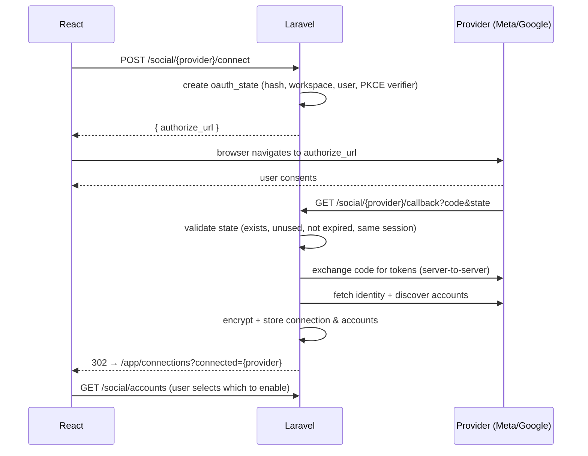

# Social Media Integration (Facebook · Instagram · YouTube)

**Status:** Draft v0.1 · Design only
Related: [PROJECT_ARCHITECTURE](PROJECT_ARCHITECTURE.md) · [API_DESIGN §7–8, §11.2](API_DESIGN.md) · [DATABASE_DESIGN §3.6–3.7](DATABASE_DESIGN.md)

> **Verification status.** Items tagged ✅ were checked against Meta's official developer docs on 2026-11-12 (Instagram content publishing; Facebook Reels publishing). Items tagged ⚠️ are from prior knowledge and **must be re-verified against current official docs before implementation** — Google's YouTube docs could not be fetched while writing this, and permission names/versions/quotas on both platforms change. Treat Graph API version as a config value (`META_GRAPH_VERSION`), not a constant.

## 1. Design goals

1. One **`SocialPlatform` strategy interface** per platform: `authorizeUrl()`, `handleCallback()`, `discoverAccounts()`, `validateToken()`, `publish()`, `checkStatus()`, `revoke()`, `constraints()`.
2. **Two providers, three platforms:** `meta` (Facebook Pages + Instagram professional accounts, one OAuth grant) and `google` (YouTube channels).
3. Tokens encrypted, scoped to a workspace, used only by queued jobs, never sent to the browser.
4. Publishing is **asynchronous, per-target, idempotent, and retryable**, with honest status ("processing" until the platform says done).
5. Start in **development mode** (works for people with roles on your app) so building isn't blocked by app review; run review in parallel.

## 2. Platform capability matrix (for our 10 s, 9:16 MP4)

| | Facebook Page | Instagram (Professional) | YouTube |
|---|---|---|---|
| Output type | Reel (`video_reels`) | Reel (`media_type=REELS`) | Video / Short (vertical) |
| Accepts our master (1080×1920, 30 fps, H.264/AAC) | ✅ (Reels: 3–90 s, 9:16, ≥ 540×960, 24–60 fps, H.264/H.265, AAC 48 kHz) | ✅ (container accepts video; exact Reel specs not listed on the publishing page — follow the Reels spec page; ⚠️ verify) | ✅ ⚠️ (Shorts: vertical/square, short duration; verify current max) |
| Upload mechanism | Resumable: start → upload to `rupload.facebook.com` (local file or `file_url`) → finish ✅ | Container with public `video_url`, **or** resumable upload to `rupload.facebook.com` ✅ | Resumable upload to YouTube upload endpoint ⚠️ |
| Async processing | Poll `GET /{video-id}?fields=status` ✅ | Poll container `status_code` (`IN_PROGRESS/FINISHED/ERROR/EXPIRED/PUBLISHED`), ≤ 1 query/min for ≤ 5 min ✅ | Processing after upload; poll `videos.list(part=status,processingDetails)` ⚠️ |
| Daily publish cap | **30 API-published Reels / Page / rolling 24 h** ✅ | **50 API-published posts / account / rolling 24 h** (`GET /{ig-user-id}/content_publishing_limit`) ✅ | **Quota-unit based (default ~10,000 units/day per Cloud project; upload ≈ 1,600 units)** ⚠️ → only a handful of uploads/day until quota extension |
| Account requirement | Page + user able to `CREATE_CONTENT` on it ✅ | Instagram **Professional** (Business/Creator) account ✅; if linked Page needs Page Publishing Authorization, publishing is blocked until completed ✅ | Google account with a YouTube channel |
| Review needed for outside users | Yes: App Review for `pages_manage_posts` etc. ✅ | Yes: App Review for each permission ✅ | Google OAuth verification (sensitive scope) + ⚠️ YouTube API compliance audit |

## 3. Shared OAuth architecture



Rules:
- **Redirect URIs:** exact-match, HTTPS in all non-local environments, one per provider per environment, registered in each developer console.
- **`state`:** 256-bit random, stored hashed, single use, 10-minute TTL, bound to session + workspace + provider. Mismatch → abort, audit log.
- **PKCE** for Google (S256). Meta: server-side code flow with app secret.
- **Least privilege:** request only the scopes in §4–6; incremental authorization if features are added later.
- **Storage:** `access_token`/`refresh_token`/`page_access_token` encrypted (Laravel `encrypted` cast, `APP_KEY` + rotation procedure). Never returned by any API resource.
- **Selection step:** after connecting, the user chooses which Pages / Instagram accounts / channels to enable (`social_accounts.is_enabled`). Only enabled accounts appear as publish targets.
- **Disconnect:** call provider revoke where available, wipe tokens, mark accounts `revoked`, keep history rows.
- **Health:** nightly `CheckSocialAccountHealth` validates tokens (debug/introspection endpoint or a cheap authenticated call), sets `expiring` (≤ 7 days) / `expired` / `needs_reconnect`, broadcasts `social.connection_updated`, and emails the user. UI shows a persistent "Reconnect" call to action.
- **Multi-tenant safety:** a connection belongs to one workspace; the same external account may be connected in several workspaces but each has its own token record.

## 4. Facebook + Instagram (Meta provider)

### 4.1 App setup (one Meta app)
- Business-type Meta app; add **Facebook Login** product (Facebook Login for Business is the current recommended configuration ⚠️ — pick at setup time) and the Instagram API products as needed.
- Required URLs for review: Privacy Policy, Terms, **Data Deletion Request callback**, **Deauthorize callback**, app icon, category, domain verification. These are built in Phase 1 (public Blade pages + callbacks in API_DESIGN §11.2).
- **Business Verification** is typically required to get Advanced Access for these permissions ⚠️ — start early; it can take days to weeks.
- Test with **app roles** (admin/developer/tester) and an Instagram professional test account while in development mode.

### 4.2 Scopes (⚠️ confirm names against the current permissions reference; Meta's Instagram publishing page says required permissions depend on the endpoints used)
| Purpose | Permissions (Facebook Login path) |
|---|---|
| List Pages the user manages | `pages_show_list` |
| Publish Reels to a Page | `pages_manage_posts`, `pages_read_engagement` ✅ (Facebook Reels guide) |
| Find the Instagram account linked to a Page | `pages_show_list`, `pages_read_engagement`, and `instagram_basic` ⚠️ |
| Publish to Instagram | `instagram_content_publish` (+ `instagram_basic`) ⚠️ |
| Business assets | `business_management` ⚠️ (only if needed for Pages owned by a Business) |

There is also an **Instagram API with Instagram Login** path (user logs in directly with Instagram; scopes like `instagram_business_basic`, `instagram_business_content_publish` ⚠️) that doesn't require a Facebook Page. **Decision for MVP:** use the Facebook Login path because the product needs Facebook Pages anyway and one grant covers both; revisit the Instagram-Login path if users want Instagram-only onboarding.

### 4.3 Token handling ⚠️
1. Code → **short-lived user token** (~1–2 h).
2. Exchange for **long-lived user token** (~60 days) with `fb_exchange_token`.
3. `GET /me/accounts` returns Pages with **Page access tokens**; Page tokens obtained from a long-lived user token are documented as non-expiring until revoked/invalidated (password change, permission removal, app removal) — verify, and still run health checks.
4. For Instagram: `GET /{page-id}?fields=instagram_business_account` → IG user id; publishing uses the user/Page token with the `instagram_content_publish` permission.
5. Store the long-lived user token + each Page token; re-run discovery on `sync`.

### 4.4 Publishing — Facebook Page Reel ✅
1. `POST /{page-id}/video_reels` `upload_phase=start` → `video_id`, `upload_url`.
2. Upload bytes to `rupload.facebook.com/video-upload/{video_id}` (`Authorization: OAuth {page_token}`, `offset`, `file_size`) **or** pass `file_url` (a presigned S3 GET URL, TTL ≥ 30 min). Prefer `file_url` so Laravel workers never buffer the file.
3. Poll `GET /{video_id}?fields=status` until processing/publishing phase completes.
4. `POST /{page-id}/video_reels` `upload_phase=finish`, `video_state=PUBLISHED` (or `SCHEDULED` + `scheduled_publish_time`; or `DRAFT`), include `description` (caption + hashtags) and optionally `title`.
5. Persist `video_id` and permalink as `external_post_id` / `external_url`.
Limits: 30 API-published Reels per Page per 24 h ✅; length 3–90 s ✅.

### 4.5 Publishing — Instagram Reel ✅
1. `POST /{ig-user-id}/media` with `media_type=REELS`, `video_url=<presigned S3 GET URL>`, `caption`, optional `share_to_feed`, `thumb_offset`/`cover_url` ⚠️ → `creation_id` (container). **The URL must be publicly reachable when Meta fetches it** — so presign with TTL ≥ 1 h and no IP restriction; alternatively use **resumable upload** (`rupload.facebook.com`, supports `file_url`) ✅.
2. Poll `GET /{container-id}?fields=status_code` (≤ once/min, up to 5 min) until `FINISHED` ✅; `ERROR`/`EXPIRED` → fail with details from `status`.
3. `POST /{ig-user-id}/media_publish` with `creation_id` → media id; fetch `permalink` for `external_url`.
4. Before publishing, check `GET /{ig-user-id}/content_publishing_limit` and defer if at cap (50 / 24 h) ✅.
Containers not published within 24 h expire ✅ — don't create containers far ahead of publish time (create at `scheduled_at − 10 min`).

### 4.6 Meta errors → our codes
| Meta signal | Our handling |
|---|---|
| OAuthException code 190 (token invalid/expired) ⚠️ | Mark connection `expired`, target `failed` (`social_needs_reconnect`), notify user |
| Permission/role errors (10, 200-range) ⚠️ | `failed` (`social_permission_missing`), explain which permission |
| Rate limit (4, 17, 32, 613, publishing caps) ⚠️ | Retry later with `next_attempt_at` (honor reset), `social_rate_limited` |
| Transient 5xx / `is_transient: true` | Retry with exponential backoff + jitter (max 5) |
| Container `ERROR` (bad media) | Permanent `failed` (`social_media_rejected`) with message; do not retry the same file |
| Page Publishing Authorization required ✅ | Permanent `failed`, instructions to complete PPA |

## 5. YouTube (Google provider) — ⚠️ whole section to be re-verified

### 5.1 Google Cloud setup
- Cloud project with **YouTube Data API v3** enabled; OAuth consent screen (External); Web application OAuth client with exact redirect URIs per environment.
- Scopes: `https://www.googleapis.com/auth/youtube.upload` (upload) and a read scope to identify the channel (`youtube.readonly`) ⚠️ — confirm the minimal set; both are sensitive/restricted-class and require **OAuth app verification** (privacy policy, homepage, domain verification, demo video of the flow).
- **Testing mode caveat:** refresh tokens issued to apps in "Testing" status expire after ~7 days ⚠️ — plan for verification before real users.

### 5.2 OAuth flow
Authorization-code + PKCE with `access_type=offline` and `prompt=consent` on first connect (to obtain a refresh token), `include_granted_scopes=true`. Store refresh token (encrypted); refresh access tokens (~1 h) on demand inside the publish job. Handle `invalid_grant` (revoked/expired) → `needs_reconnect`.
Account discovery: `channels.list(part=snippet, mine=true)` → one `youtube_channel` account (brand-account selection happens in Google's consent UI).

### 5.3 Upload
1. Resumable upload session: `POST https://www.googleapis.com/upload/youtube/v3/videos?uploadType=resumable&part=snippet,status` with metadata:
   - `snippet`: `title` (≤ 100 chars), `description` (≤ 5000 bytes; include `#Shorts` and hashtags), `tags[]`, `categoryId`, `defaultLanguage`
   - `status`: `privacyStatus` (`private|unlisted|public`), `selfDeclaredMadeForKids` (**required choice**), `containsSyntheticMedia` (disclosure of AI-generated realistic content; field availability/semantics ⚠️ verify)
2. PUT the bytes in chunks (e.g. 8 MiB, multiples of 256 KiB) with resume on interruption. The worker streams from S3 (range reads) — never loads the whole file in memory.
3. Response includes the video id → `external_post_id`; `external_url = https://youtube.com/watch?v={id}` (and `/shorts/{id}`).
4. Optional: `thumbnails.set` (requires a verified channel ⚠️).
5. Poll `videos.list(part=status,processingDetails)` until `uploadStatus=processed`.

### 5.4 Quota and audit — the biggest YouTube risk ⚠️
- Default quota is on the order of **10,000 units/day per Cloud project**, and `videos.insert` costs on the order of **1,600 units** → roughly **6 uploads per day for the whole product** until a quota extension is approved. This quota is **shared by all users of your app**, not per user.
- API projects that haven't passed YouTube's **API compliance audit** may have uploaded videos **forced to private** ⚠️.
- **Action:** in Phase 1 file the quota-extension / compliance-audit request with a real screencast and policy docs; until approved, restrict YouTube publishing to internal/test channels and show honest UI ("YouTube publishing is in limited beta").
- Mitigations: central **quota accountant** (count units per call, queue uploads when near the cap, resets at midnight Pacific ⚠️), prioritise scheduled posts, surface `quotaExceeded` as `social_rate_limited` with a retry time.

### 5.5 YouTube errors → our codes
`401/invalid_grant` → `social_needs_reconnect` · `quotaExceeded` → delay until reset · `uploadLimitExceeded` (channel daily limit) → delay + notify · `forbidden` (channel suspended, no channel) → permanent · `5xx` / upload interrupted → resume then retry.

## 6. Publish job design (all platforms)

```
PublishToTarget(target_id)   [queue: publishing, tries=5, backoff=[30,120,600,1800,3600]]
 1. Lock target row; if status ∈ {published, canceled} → exit (idempotent)
 2. Verify: publication approved video (latest review == approved_review_id), account active & enabled
 3. Rate-limit gate (per-account + platform caps); if blocked → release with next_attempt_at
 4. Mint presigned S3 GET URL (TTL by platform) — never stored
 5. platform->publish(...) → returns {external_id?, container_id?, state}
 6. Persist container/external ids BEFORE polling (so retries resume instead of duplicating)
 7. If async processing → dispatch PollPlatformStatus(target) with platform-specific delays
 8. On success: status=published, external_url, broadcast event; on failure: classify (retryable vs permanent) and record publication_attempts
```
**Duplicate-post protection:** `publication_targets` stores `platform_container_id`/`external_post_id`; the job refuses to create a second container/upload if one exists and is still valid; Instagram `media_publish` is only called once per container; unique `(publication_id, social_account_id)`.
**Partial failure:** publication status = `partial` when some targets succeed; UI offers per-target retry. No automatic rollback/deletion of successful posts.
**Scheduling:** `scheduled_at` stored in UTC; scheduler enqueues `PublishToTarget` at due time; platform-native scheduling (`SCHEDULED` for Facebook) is optional and off by default so we keep one source of truth.

## 7. Platform constraints enforced before enqueue (`constraints()`)

| Field | Facebook | Instagram | YouTube |
|---|---|---|---|
| Caption/description | Generous (validate ≤ 2000 as safe default) | ≤ 2200 chars, ≤ 30 hashtags ⚠️ | Description ≤ 5000 bytes |
| Title | optional | — | ≤ 100 chars, required |
| Hashtags | in description | in caption | in description/tags |
| Video | 9:16, 3–90 s | Reel spec | vertical, short |
| Extra | — | `share_to_feed`, cover | `privacyStatus`, made-for-kids, synthetic-media flag |

The UI reads `capabilities` from `GET /social/accounts` and validates inline; the API validates again.

## 8. Compliance & review checklist

**Meta (per permission):** screencast of the full flow (login → connect → select Page/IG → generate → approve → publish), clear permission justifications, test credentials/accounts, privacy policy URL, ToS URL, data-deletion callback live, deauthorize callback live, Business Verification complete, app set to Live.
**Google:** consent screen branding, verified domain, privacy policy that discloses YouTube API Services use and links to Google's privacy policy, demo video, scope justifications; **YouTube API compliance audit / quota extension** form.
**Our policies:** terms say users must have rights to uploaded images and music; AI-content disclosure reminder in the Publish screen and API flags set where supported; no auto-publish without approval; tokens deletable on request; audit log of connect/disconnect/publish.

## 9. Testing strategy
- **Fake platform server** (WireMock/Prism or a small Laravel test double) implementing the container/upload/status flows for CI.
- **Contract fixtures** recorded from real sandbox calls (tokens redacted).
- **Manual test matrix:** Page-only user, IG linked to Page, IG not linked, Page needing PPA, expired token, revoked permission, token for wrong role, YouTube account with no channel, quota exceeded, interrupted upload resume.
- **Staging** uses dedicated test Page, test Instagram professional account, and a test YouTube channel.

## 10. Operational notes
- Pin `META_GRAPH_VERSION`; calendar reminder to upgrade before each version's sunset; log the version used per call.
- Alert on: spike in `needs_reconnect`, publish failure rate per platform, quota consumption > 70 %, webhook callback failures.
- Keep a runbook: "Rotate Meta app secret", "Rotate Google client secret", "Mass token invalidation event".
